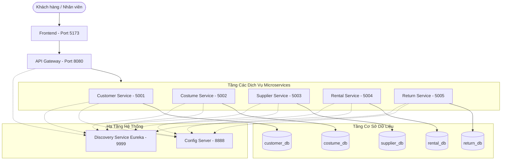
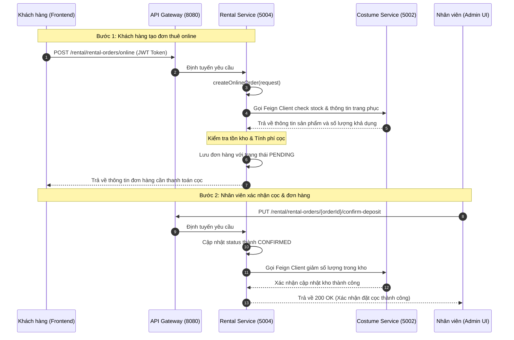
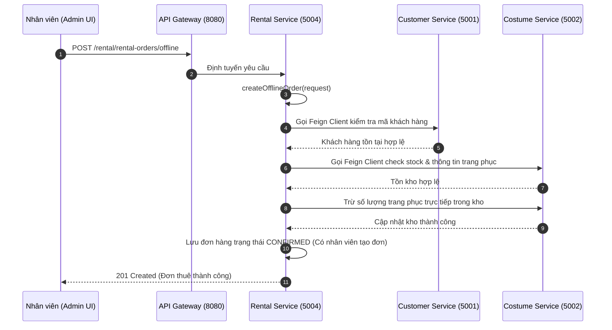
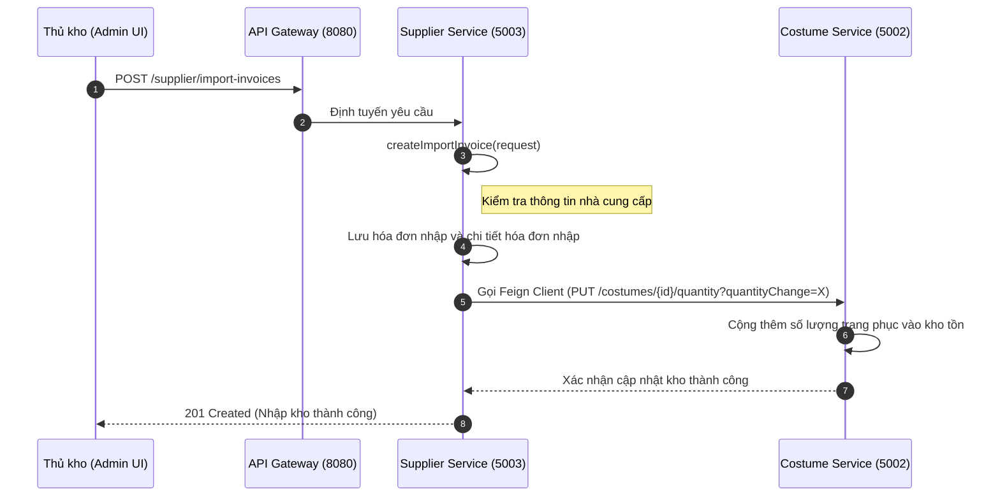
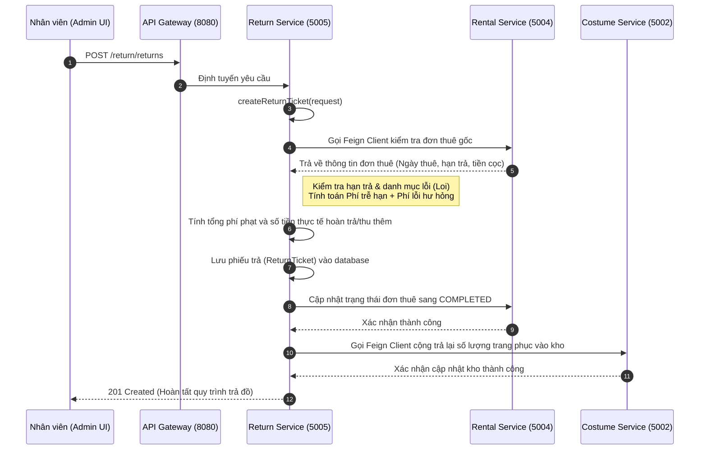

# 👗 Hệ Thống Quản Lý Thuê Trang Phục (Costume Rental Management System)

[](https://github.com/hungdn1701/microservices-assignment-starter/stargazers)
[](https://github.com/hungdn1701/microservices-assignment-starter/network/members)
[](LICENSE)

Giải pháp tự động hóa toàn diện quy trình quản lý và vận hành thuê trang phục. Hệ thống hỗ trợ quản lý nhập kho từ nhà cung cấp, thực hiện giao dịch thuê trực tuyến (Online) và trực tiếp tại cửa hàng (In-store/Offline), quản lý tồn kho thời gian thực, và xử lý trả trang phục đi kèm thuật toán tự động tính phí phạt hư hại hoặc trễ hạn.

Dự án được xây dựng dựa trên kiến trúc **Microservices (Kiến trúc hướng dịch vụ)** sử dụng hệ sinh thái **Java Spring Boot & Spring Cloud**, kết hợp cơ sở dữ liệu độc lập **MySQL** cho từng dịch vụ và đóng gói toàn bộ qua **Docker Compose**.

> **Tài liệu cài đặt & Chạy nhanh?** Xem phần [Hướng Dẫn Cài Đặt Chi Tiết](#-hướng-dẫn-cài-đặt-chi-tiết-từ-a---z) bên dưới hoặc xem [`GETTING_STARTED.md`](GETTING_STARTED.md) để biết thêm chi tiết.

---

## 👥 Thành Viên Nhóm & Vai Trò (Team Members)

| Họ và Tên | Mã Sinh Viên | Vai Trò | Dịch Vụ Đảm Nhiệm (Services) |
| :--- | :--- | :--- | :--- |
| **Lý Chí Công** | B22DCCN088 | Thành viên | Costume Service, Supplier Service |
| **Phạm Văn Đức** | B22DCCN244 | Thành viên | Customer Service, Rental Service |
| **Đỗ Tuấn Nghĩa** | B22DCCN604 | Thành viên | Return Service |

---

## 🎯 Nghiệp Vụ Hệ Thống (Business Process)

Hệ thống tập trung tự động hóa toàn bộ vòng đời của một trang phục cho thuê:
* **Lĩnh vực hoạt động (Domain)**: Quản lý thuê trang phục (Costume Rental Management).
* **Đối tượng sử dụng (Actors)**: Khách hàng (Customer), Nhân viên bán hàng (Sales Staff), Quản lý kho (Warehouse Manager), Nhà cung cấp (Supplier).
* **Phạm vi hệ thống (Scope)**:
  * Nhập hàng từ các nhà cung cấp bên ngoài nhằm bổ sung số lượng tồn kho.
  * Khách hàng duyệt sản phẩm, tạo đơn thuê online hoặc nhân viên tạo đơn trực tiếp tại quầy.
  * Quản lý trạng thái đơn thuê (Đặt cọc, Nhận đồ, Đang thuê, Hủy đơn).
  * Trả đồ, kiểm tra tình trạng hư hại của trang phục và tự động tính toán phí phạt dựa trên danh mục lỗi (bị rách, bẩn, mất đồ, trễ hạn).

---

## 🏛️ Kiến Trúc Hệ Thống (System Architecture)

Hệ thống được thiết kế theo mô hình Microservices với cơ sở dữ liệu riêng cho từng dịch vụ nhằm đảm bảo tính độc lập và khả năng mở rộng.

### 1. Sơ Đồ Kiến Trúc (Architecture Diagram)



### 2. Các Mẫu Thiết Kế Được Sử Dụng (Architectural Patterns)

| Mẫu thiết kế | Trạng thái | Lý do lựa chọn & Vai trò kỹ thuật |
| :--- | :---: | :--- |
| **API Gateway** | ✅ | Điểm tiếp nhận yêu cầu tập trung từ Frontend, chịu trách nhiệm định tuyến (routing) và kiểm tra xác thực JWT. |
| **Database per Service** | ✅ | Đảm bảo tính lỏng lẻo (loose coupling) của microservices. Mỗi service sở hữu database riêng, tránh xung đột và dễ dàng thay đổi cấu trúc dữ liệu. |
| **Service Discovery** | ✅ | Sử dụng Netflix Eureka. Các service tự động đăng ký vị trí mạng của mình để API Gateway và các service khác có thể gọi lẫn nhau mà không cần cấu hình cứng IP. |
| **Externalized Config** | ✅ | Cấu hình tập trung bằng Spring Cloud Config Server giúp quản lý file cấu hình (`.yaml`/`.properties`) cho tất cả services từ một nguồn duy nhất. |
| **Inter-service Communication** | ✅ | Giao tiếp nội bộ đồng bộ giữa các services thông qua **OpenFeign Client** (gọi API nội bộ được cân bằng tải qua Eureka ID). |

---

## 📦 Chi Tiết Các Dịch Vụ (System Components)

| Thành phần | Công nghệ sử dụng | Port mặc định | Nhiệm vụ chính |
| :--- | :--- | :---: | :--- |
| **Frontend** | React / Vite | `5173` | Giao diện người dùng cho khách hàng thuê đồ và nhân viên quản lý đơn, nhập kho, trả đồ. |
| **API Gateway** | Spring Cloud Gateway | `8080` | Định tuyến các request từ client đến các service đích, xử lý CORS, xác thực và phân quyền JWT. |
| **Discovery Service** | Netflix Eureka Server | `9999` | Quản lý vòng đời và thông tin đăng ký hoạt động của các service instance. |
| **Config Service** | Spring Cloud Config Server | `8888` | Quản lý và cung cấp cấu hình tập trung cho toàn bộ hệ thống. |
| **Customer Service** | Spring Boot, JPA, MySQL | `5001` | Quản lý tài khoản người dùng, phân quyền đăng nhập (Admin/Staff/Customer), sinh mã JWT. |
| **Costume Service** | Spring Boot, JPA, MySQL | `5002` | Quản lý danh mục trang phục, giá thuê, cập nhật và đồng bộ số lượng tồn kho thời gian thực. |
| **Supplier Service** | Spring Boot, JPA, MySQL | `5003` | Quản lý thông tin nhà cung cấp và lịch sử tạo hóa đơn nhập hàng hóa bổ sung kho. |
| **Rental Service** | Spring Boot, JPA, MySQL | `5004` | Xử lý giao dịch thuê đồ (Online / Offline), quản lý trạng thái thanh toán đặt cọc. |
| **Return Service** | Spring Boot, JPA, MySQL | `5005` | Tiếp nhận trả đồ, áp lỗi hư hại, tính toán hoàn tiền cọc hoặc thu thêm phí phạt. |

---

## 🗄️ Thiết Kế Cơ Sở Dữ Liệu (Database Models)

Hệ thống sử dụng cơ sở dữ liệu MySQL. Phân rã dữ liệu thành các database riêng biệt:

| Database | Tên bảng chính | Thực thể ánh xạ (JPA Entity) | Mô tả vai trò dữ liệu |
| :--- | :--- | :--- | :--- |
| `customer_db` | `users`, `roles` | `User`, `Role` | Lưu trữ thông tin tài khoản, mật khẩu (mã hóa BCrypt), và phân quyền. |
| `costume_db` | `costumes` | `Costume` | Thông tin chi tiết trang phục, số lượng hiện tại, giá thuê cơ bản. |
| `supplier_db` | `suppliers`, `import_invoices` | `Supplier`, `ImportInvoice` | Quản lý nhà cung cấp và thông tin chi tiết từng đợt nhập hàng. |
| `rental_db` | `rental_orders`, `rental_details` | `RentalOrder`, `RentalDetail` | Lưu vết đơn đặt thuê, danh sách trang phục được thuê và trạng thái đơn. |
| `return_db` | `return_tickets`, `lois` | `ReturnTicket`, `Loi` | Danh mục lỗi phạt (Loi) và thông tin phiếu trả trang phục của khách hàng. |

---

## 📡 Quy Trình Nghiệp Vụ Chi Tiết (Detailed Communication Flows)

### 1. Luồng Thuê Trang Phục Online (Online Rental Flow)

Khách hàng tạo đơn trên website ở trạng thái `PENDING`. Sau khi chuyển khoản đặt cọc thành công, nhân viên xác nhận để chuyển đơn sang `CONFIRMED`.



### 2. Luồng Thuê Trang Phục Tại Cửa Hàng (Offline Rental Flow)

Khách hàng đến trực tiếp cửa hàng lựa chọn đồ. Nhân viên quét mã/chọn trang phục và tạo đơn trực tiếp, đơn hàng được chuyển ngay sang trạng thái `CONFIRMED`.



### 3. Luồng Nhập Hàng Từ Nhà Cung Cấp (Costume Import Flow)

Nhân viên quản lý kho thực hiện lập hóa đơn nhập hàng từ nhà cung cấp để tăng số lượng tồn kho.



### 4. Luồng Trả Trang Phục & Tính Phí Phạt (Return & Penalty Flow)

Khi khách hàng mang trang phục đến trả, nhân viên kiểm tra tình trạng thực tế để lập phiếu trả đồ. Hệ thống tự động tính toán tổng phí phạt nếu có lỗi phát sinh.



---

## 📡 Đặc Tả API Specs (API Documentation)

Chi tiết API của từng service được thiết kế theo chuẩn OpenAPI 3.0, lưu trữ tại thư mục `docs/api-specs/`:

* 📊 **Rental Service**: [`docs/api-specs/rental-service.yaml`](docs/api-specs/rental-service.yaml)
* 👤 **Customer Service**: [`docs/api-specs/customer-service.yaml`](docs/api-specs/customer-service.yaml)
* 👗 **Costume Service**: [`docs/api-specs/costume-service.yaml`](docs/api-specs/costume-service.yaml)
* 🤝 **Supplier Service**: [`docs/api-specs/supplier-service.yaml`](docs/api-specs/supplier-service.yaml)
* ↩️ **Return Service**: [`docs/api-specs/return-service.yaml`](docs/api-specs/return-service.yaml)

---

## 🚀 Hướng Dẫn Cài Đặt Chi Tiết Từ A - Z

Hệ thống được đóng gói và vận hành dễ dàng thông qua các tệp Docker cấu hình sẵn.

### 1. Chuẩn Bị Môi Trường

Đảm bảo máy tính của bạn đã cài đặt các công cụ sau:
* **Docker** & **Docker Compose**
* **Git**

### 2. Các Bước Khởi Chạy Hệ Thống

**Bước 1: Clone mã nguồn dự án**
```bash
git clone https://github.com/jnp2018/mid-project-244604088.git
cd mid-project-244604088
```

**Bước 2: Cấu hình biến môi trường**
Sao chép tệp cấu hình mẫu và chỉnh sửa các tham số nếu cần thiết:
```bash
cp .env.example .env
```

**Bước 3: Khởi chạy toàn bộ hệ thống bằng Docker Compose**
Docker Compose sẽ tự động build các image dịch vụ, thiết lập mạng nội bộ (Bridge Network) và chạy các container:
```bash
docker compose up --build
```
*(Nếu chạy ở chế độ nền (Background), thêm tham số `-d`: `docker compose up -d --build`)*

### 3. Kiểm Tra Trạng Thái Hoạt Động (Health Verification)

Bạn có thể kiểm tra trạng thái hoạt động của các dịch vụ bằng lệnh `curl` hoặc truy cập trực tiếp từ trình duyệt:

```bash
curl http://localhost:8080/health   # API Gateway
curl http://localhost:5001/health   # Customer Service
curl http://localhost:5002/health   # Costume Service
curl http://localhost:5003/health   # Supplier Service
curl http://localhost:5004/health   # Rental Service
curl http://localhost:5005/health   # Return Service
```

Để theo dõi giao diện Dashboard Eureka để xem danh sách các instance dịch vụ đã đăng ký thành công:
* **Địa chỉ**: `http://localhost:9999` (Eureka Dashboard)

Để xem tài khoản quản trị mặc định hoặc tùy chỉnh cấu hình ban đầu:
* **Config Server**: `http://localhost:8888`

---

## 🛠️ Phát Triển Cục Bộ (Local Development Guide)

Trong trường hợp bạn muốn chạy hoặc sửa đổi mã nguồn của một dịch vụ cụ thể dưới local mà không dùng Docker cho dịch vụ đó:
1. Đảm bảo container cơ sở dữ liệu `mysql` của Docker vẫn đang chạy (`docker compose up mysql`).
2. Vào thư mục của dịch vụ cụ thể trong `services/` (Ví dụ: `cd services/rental-service`).
3. Chạy ứng dụng Spring Boot bằng maven wrapper:
   ```bash
   ./mvnw spring-boot:run
   ```

---

## 📄 Bản Quyền (License)

Dự án này sử dụng bản quyền [MIT License](LICENSE).
