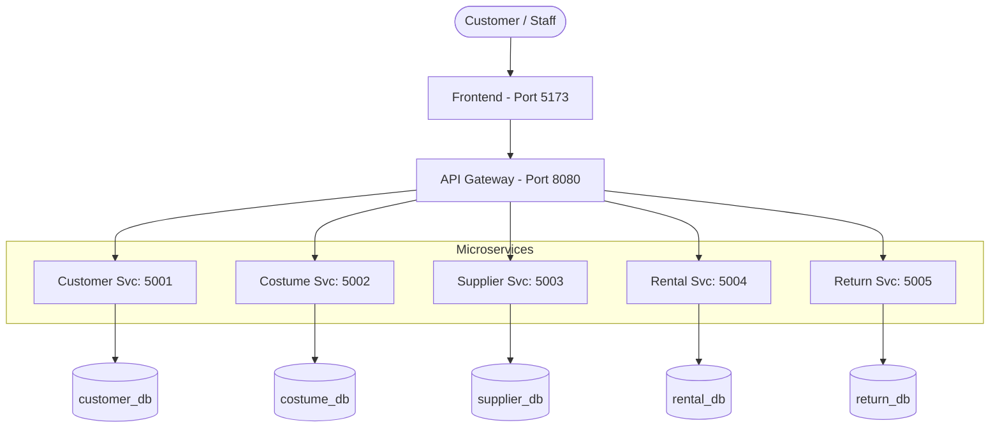

# Costume Rental Management System (Microservices)

[](https://github.com/hungdn1701/microservices-assignment-starter/stargazers)
[](https://github.com/hungdn1701/microservices-assignment-starter/network/members)
[](LICENSE)

> An automated solution for the costume rental workflow, enabling efficient inventory import management, online/offline rental transactions, and return processing with automatic penalty fee calculation.

> **New to this repo?** See [`GETTING_STARTED.md`](GETTING_STARTED.md) for setup instructions and workflow guide.

---

## Team Members

| Name           | Student ID | Role   | Services                          |
| -------------- | ---------- | ------ | --------------------------------- |
| Lý Chí Công    | B22DCCN088 | Member | Costume Service, Supplier Service |
| Phạm Văn Đức   | B22DCCN244 | Member | Customer Service, Rental Service  |
| Đỗ Tuấn Nghĩa  | B22DCCN604 | Member | Return Service                    |

---

## Business Process

The system focuses on automating the full lifecycle of a rental costume:
- **Domain**: Costume Rental Management.
- **Actors**: Customer, Sales Staff, Warehouse Staff, Supplier.
- **Scope**: Inventory import from suppliers, rental booking (Online/Offline), real-time stock management, return processing with automatic damage penalty calculation.

---

## Architecture



| Component            | Responsibility                             | Tech Stack           | Port |
| -------------------- | ------------------------------------------ | -------------------- | ---- |
| **Frontend**         | Web user interface                         | React / Next.js      | 5173 |
| **Gateway**          | Centralized traffic routing, Authentication | Spring Cloud Gateway | 8080 |
| **Customer Service** | Authentication & User management           | Spring Boot          | 5001 |
| **Costume Service**  | Product catalog & Inventory management     | Spring Boot          | 5002 |
| **Supplier Service** | Inventory import & Supplier management     | Spring Boot          | 5003 |
| **Rental Service**   | Rental transaction processing              | Spring Boot          | 5004 |
| **Return Service**   | Return processing & Penalty fee calculation | Spring Boot          | 5005 |

> Full documentation: [`docs/architecture.md`](docs/architecture.md) · [`docs/analysis-and-design.md`](docs/analysis-and-design.md)

---

## Getting Started

```bash
# Clone the project
git clone https://github.com/jnp2018/mid-project-244604088
cd mid-project-244604088

# Configure environment
cp .env.example .env

# Start the entire system with Docker
docker compose up --build
```

### Verify

```bash
curl http://localhost:8080/health   # Gateway
curl http://localhost:5001/health   # Customer Service
curl http://localhost:5002/health   # Costume Service
curl http://localhost:5003/health   # Supplier Service
curl http://localhost:5004/health   # Rental Service
curl http://localhost:5005/health   # Return Service
```

---

## API Documentation

- [Customer Service Spec](docs/api-specs/customer-service.yaml)
- [Costume Service Spec](docs/api-specs/costume-service.yaml)
- [Rental Service Spec](docs/api-specs/rental-service.yaml)
- [Supplier Service Spec](docs/api-specs/supplier-service.yaml)
- [Return Service Spec](docs/api-specs/return-service.yaml)

---

## License

This project uses the [MIT License](LICENSE).

> Template by [Hung Dang](https://github.com/hungdn1701) · [Template guide](GETTING_STARTED.md)
# Thue_trang_phuc
