# Analysis and Design — Business Process Automation Solution

> **Goal**: Analyze a specific business process and design a service-oriented automation solution (SOA/Microservices).
> Scope: 4–6 week assignment — focus on **one business process**, not an entire system.

**References:**

1. _Service-Oriented Architecture: Analysis and Design for Services and Microservices_ — Thomas Erl (2nd Edition)
2. _Microservices Patterns: With Examples in Java_ — Chris Richardson
3. _Bài tập — Phát triển phần mềm hướng dịch vụ_ — Hung Dang (available in Vietnamese)

---

## Part 1 — Analysis Preparation

### 1.1 Business Process Definition

Describe or diagram the high-level Business Process to be automated.

- **Domain**: Costume Rental Management
- **Business Process**: Costume Rental Operations (Online & In-store), Inventory Import Management, and Return Processing.
- **Actors**:
  - **Users**: Customer, Sales Staff, Warehouse Manager, Supplier.
  - **Systems**: Microservices (Rental, Costume, Customer, Supplier, Return).
- **Scope**: Covers the full product and transaction lifecycle:
  - Inventory import from Suppliers.
  - Browsing, ordering and payment (Online/In-store).
  - Real-time inventory management.
  - Costume return processing, condition inspection, and automatic penalty fee calculation.

**Process Diagrams:**

Online Costume Rental:
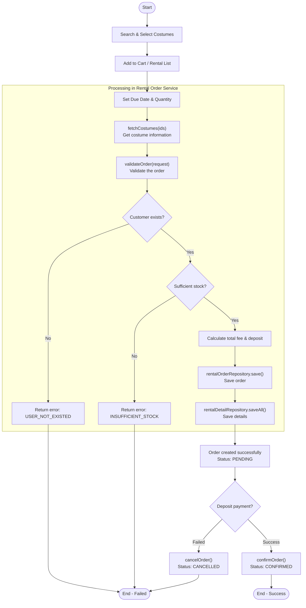

Offline (In-store) Costume Rental:
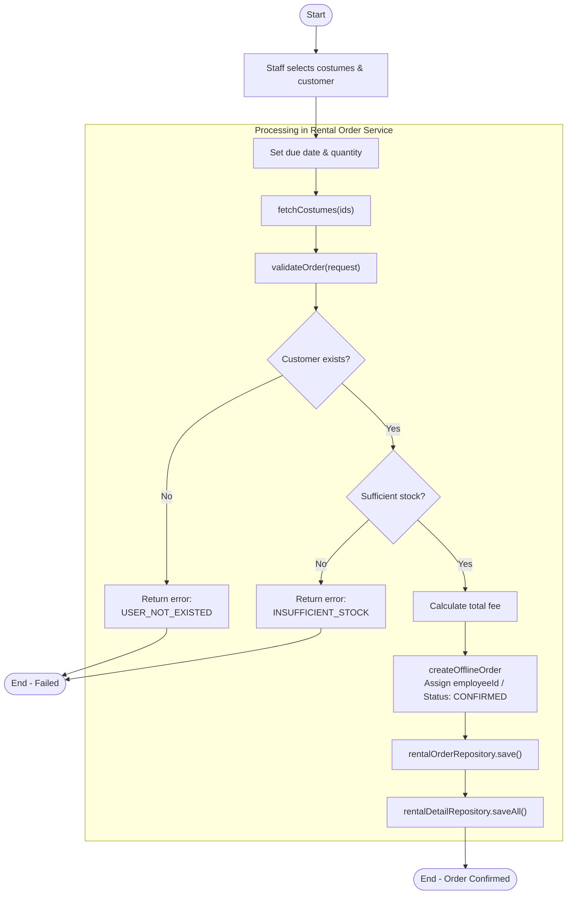

Costume Import (from Supplier):
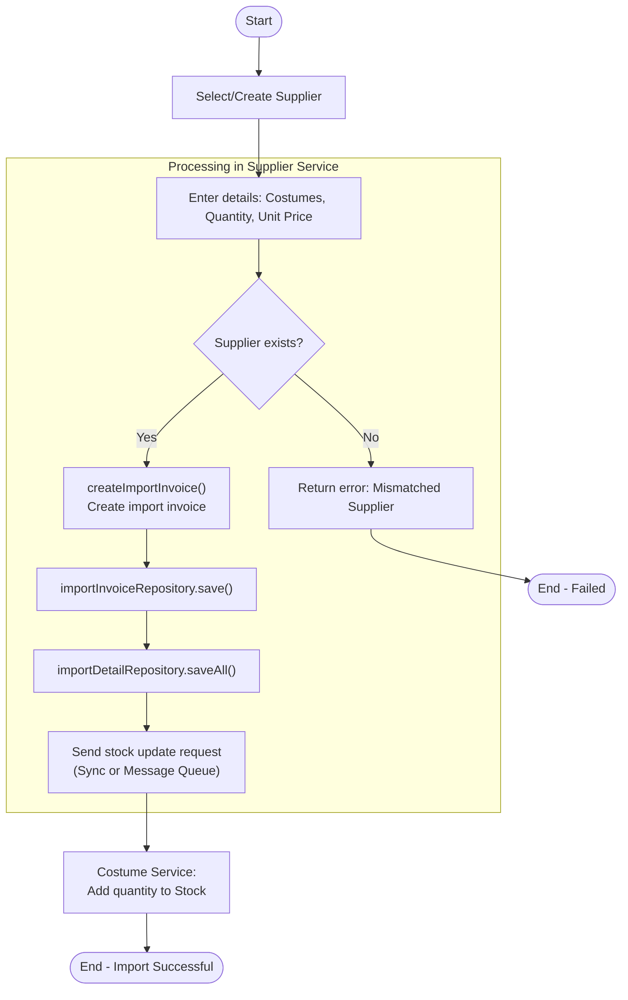

Costume Return & Penalty Processing:
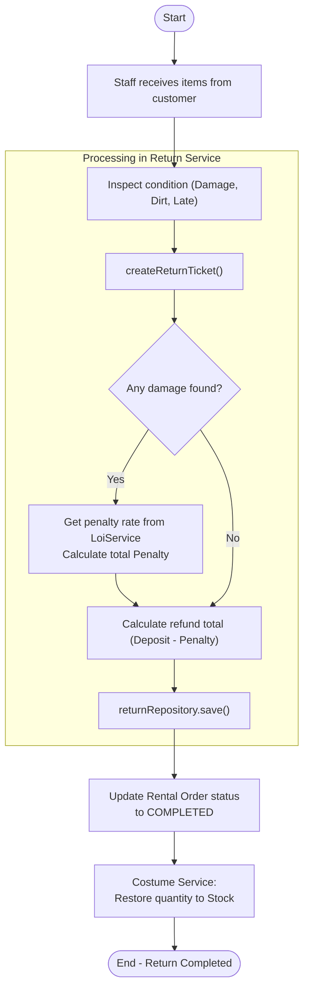

### 1.2 Existing Automation Systems

None — the process is currently performed manually.

### 1.3 Non-Functional Requirements

Non-functional requirements serve as input for identifying Utility Service and Microservice Candidates in step 2.7.

| Requirement  | Description |
| ------------ | ----------- |
| Performance  | System responds quickly (< 1s) for search and ordering operations. |
| Security     | User authentication via JWT, role-based access control (Admin/Customer). |
| Scalability  | Microservices architecture allows independent scaling of services under increased load. |
| Availability | System must remain operational 24/7 for customers to browse and rent costumes. |

---

## Part 2 — REST/Microservices Modeling

### 2.1 Decompose Business Process & 2.2 Filter Unsuitable Actions

Decompose the process from 1.1 into granular actions. Mark actions unsuitable for service encapsulation.

| #  | Action | Actor | Description | Suitable? |
| -- | ------ | ----- | ----------- | --------- |
| 1  | Search for costumes | Customer | Browse costume list by name or category. | ✅ |
| 2  | View details & select date | Customer | View detailed information and select the due date. | ✅ |
| 3  | Check stock availability | System | Verify sufficient costume quantity in stock. | ✅ |
| 4  | Calculate cost | System | Compute rental fee and deposit based on rental duration. | ✅ |
| 5  | Create order (Pending) | System | Save order to database with payment-pending status. | ✅ |
| 7  | Confirm order | System | Change order status to 'Confirmed' after payment. | ✅ |
| 8  | Receive costume from supplier | Staff | Retrieve supplier info and create an import invoice. | ✅ |
| 9  | Add quantity to stock | System | Update the costume quantity in inventory. | ✅ |
| 10 | Inspect returned item & damage | Staff | Receive items from customer, check for damage/dirt/late. | ✅ |
| 11 | Calculate penalty fee | System | Compute fees based on the damage/penalty catalog. | ✅ |
| 12 | Refund deposit / collect extra | Staff | Process deposit refund or collect additional fee from customer. | ✅ |

> Actions marked ❌: manual-only, require human judgment, or cannot be encapsulated as a service.

### 2.3 Entity Service Candidates & Capability Mapping

Identify business entities and group reusable (agnostic) actions into Entity Service Candidates. The table below shows the detailed mapping between **business functions** and the **responsible microservice**:

| Business Domain | Detailed Functions | Responsible Microservice |
|:---:| --- | --- |
| **Auth & User** | • Register new customer account.<br/>• Login & generate JWT Token.<br/>• Manage customer profile (CRUD).<br/>• Manage employee profile (CRUD). | **Customer Service** |
| **Product & Inventory** | • Manage costume catalog (CRUD).<br/>• Look up information & rental price.<br/>• Update actual stock quantity.<br/>• Revenue statistics per costume. | **Costume Service** |
| **Rental Transactions** | • Create Online rental order (PENDING).<br/>• Create Offline rental order (CONFIRMED).<br/>• Confirm deposit & order confirmation.<br/>• Manage order lifecycle status. | **Rental Service** |
| **Return Transactions** | • Receive returned items.<br/>• Calculate penalty fees (damage/late/loss).<br/>• Manage asset damage catalog.<br/>• Calculate deposit refund. | **Return Service** |
| **Inventory Import** | • Manage Supplier information (CRUD).<br/>• Create import invoices.<br/>• Track import history. | **Supplier Service** |

---

**Entity Service Candidate details:**

| Entity   | Service Candidate  | Agnostic Actions |
| -------- | ------------------ | ---------------- |
| Costume  | Costume Service    | Create/Update/Delete costume, Update stock quantity, Lookup price. |
| Customer | Customer Service   | Manage customer profile, View rental history. |
| Rental   | Rental Service     | Create rental order, Update order status, Calculate due date. |
| Supplier | Supplier Service   | Manage supplier, Save import invoice. |
| Return   | Return Service     | Create return ticket, Manage damage/penalty catalog. |

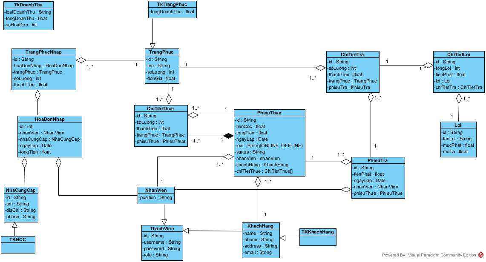

### 2.4 Task Service Candidate

Group process-specific (non-agnostic) actions into a Task Service Candidate.

| Non-agnostic Action | Task Service Candidate |
| ------------------- | ---------------------- |
| Full rental workflow (from order creation to confirmation) | Rental Service (Composition) |
| Return processing and penalty fee calculation | Return Service |
| Inventory import from supplier | Supplier Service |

### 2.5 Identify Resources

Map entities/processes to REST URI Resources.

| Entity / Process  | Resource URI        |
| ----------------- | ------------------- |
| Costume           | `/costumes`         |
| Customer          | `/customers`        |
| Rental Order      | `/rental-orders`    |
| Supplier          | `/suppliers`        |
| Import Invoice    | `/import-invoices`  |
| Return Ticket     | `/returns`          |
| Damage Catalog    | `/errors`           |

### 2.6 Associate Capabilities with Resources and Methods

| Service Candidate | Capability | Resource | HTTP Method |
| ----------------- | ---------- | -------- | ----------- |
| Costume Service   | Search costumes | `/costumes` | GET |
| Rental Service    | Create new order | `/rental-orders/online` | POST |
| Customer Service  | Get customer info | `/customers/{id}` | GET |
| Rental Service    | Update rental order | `/rental-orders/{orderId}` | PUT |

### 2.7 Utility Service & Microservice Candidates

Based on Non-Functional Requirements (1.3) and Processing Requirements, identify cross-cutting utility logic or logic requiring high autonomy/performance.

| Candidate          | Type (Utility / Microservice) | Justification |
| ------------------ | ----------------------------- | ------------- |
| API Gateway        | Utility                       | Single entry point, handles routing and JWT authentication. |
| Config Service     | Utility                       | Centralized configuration management for the entire system. |
| Discovery Service  | Utility                       | Enables services to locate each other without hard-coded IPs. |
| Rental Service     | Microservice                  | Handles the most critical business logic, requires high autonomy. |

### 2.8 Service Composition Candidates

Interaction diagrams showing how Service Candidates collaborate to fulfill the business process.

Online Costume Rental:

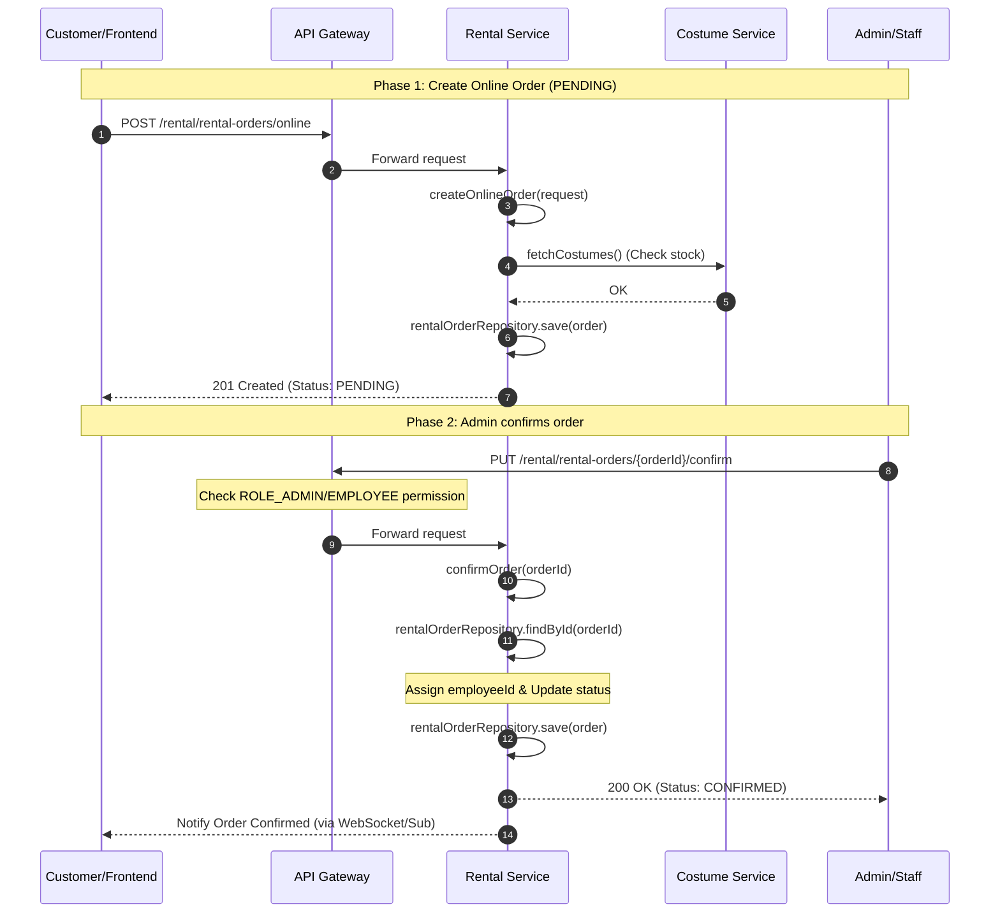

Offline (In-store) Costume Rental:

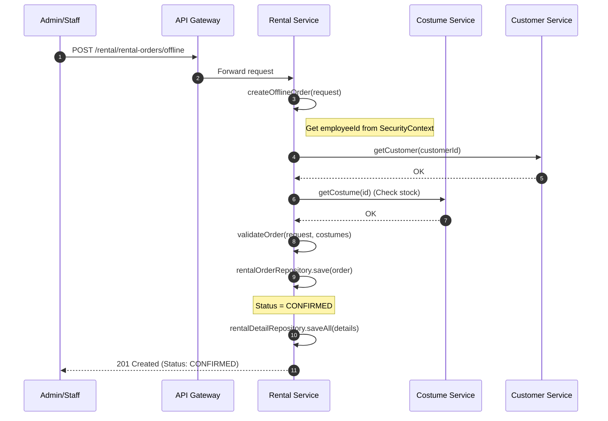

Costume Import (from Supplier):

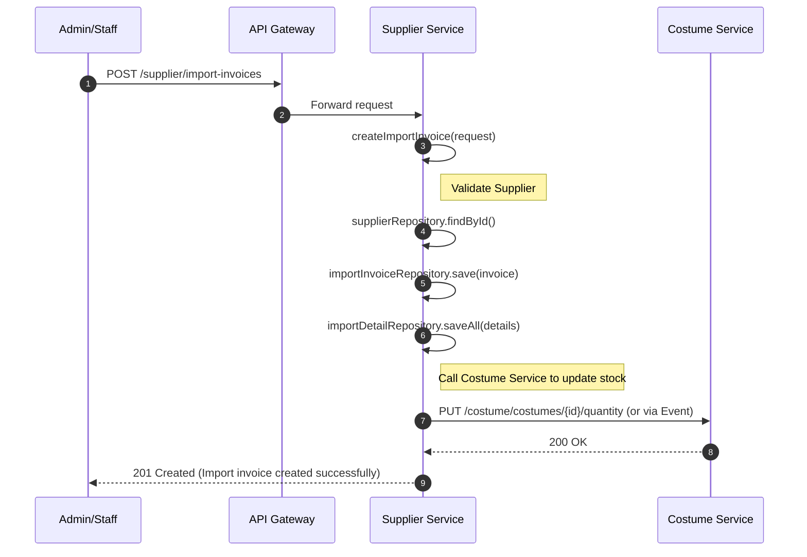

Costume Return & Penalty Processing:

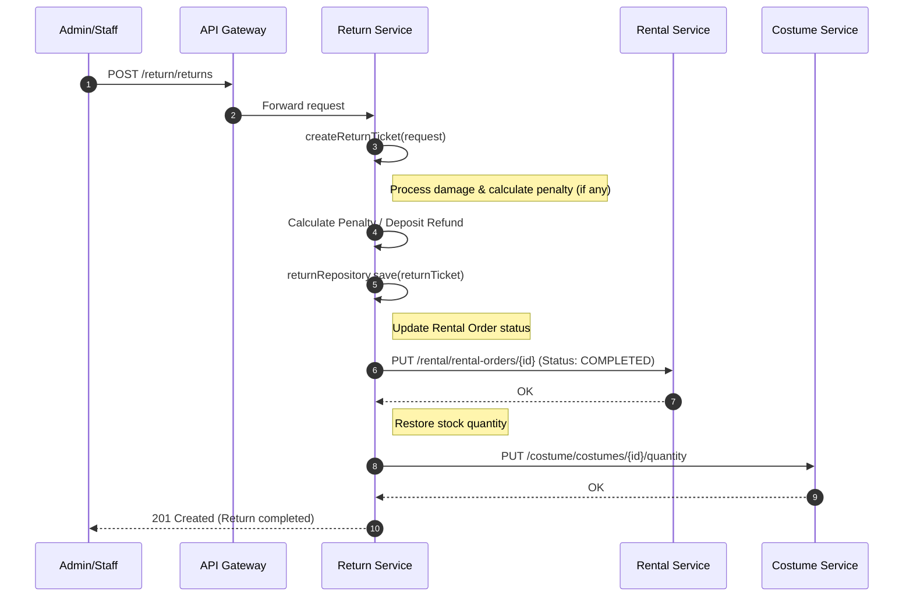

---

## Part 3 — Service-Oriented Design

### 3.1 Uniform Contract Design

Service Contract specification for each service. Full OpenAPI specs:

- [`docs/api-specs/rental-service.yaml`](api-specs/rental-service.yaml)
- [`docs/api-specs/customer-service.yaml`](api-specs/customer-service.yaml)
- [`docs/api-specs/costume-service.yaml`](api-specs/costume-service.yaml)
- [`docs/api-specs/supplier-service.yaml`](api-specs/supplier-service.yaml)
- [`docs/api-specs/return-service.yaml`](api-specs/return-service.yaml)

**Rental Service: `localhost:8080/rental`**

| Endpoint | Method | Description | Request Body | Response (200/201) |
| -------- | ------ | ----------- | ------------ | ------------------ |
| `/rental-orders/online` | POST | Create an online rental order (by customer) | `CreateRentalOrderRequest` | `RentalOrderResponse` |
| `/rental-orders/offline` | POST | Create an in-store rental order (by staff) | `CreateRentalOrderRequest` | `RentalOrderResponse` |
| `/rental-orders` | GET | Get order list (Admin/Employee) | (Query: page, size, status, type, unpaid) | `PageRentalOrderResponse` |
| `/rental-orders/{orderId}` | GET | Get order details by ID | N/A | `RentalOrderResponse` |
| `/rental-orders/{orderId}/confirm` | PUT | Confirm order (Staff) | N/A | `RentalOrderResponse` |
| `/rental-orders/{orderId}/cancel` | PUT | Cancel order | (Query: reason) | `RentalOrderResponse` |
| `/rental-orders/{orderId}/pickup` | PUT | Mark customer as picked up | N/A | `RentalOrderResponse` |
| `/rental-orders/{orderId}/confirm-deposit` | PUT | Confirm deposit received | N/A | `RentalOrderResponse` |
| `/rental-orders/customer/{customerId}` | GET | Get orders by customer | N/A | `PageRentalOrderResponse` |

**Request/Response details (Rental Service):**

- **CreateRentalOrderRequest:**
```json
{
  "customerId": "cust-123",
  "dueDate": "2024-05-01T17:00:00Z",
  "items": [
    {
      "costumeId": "cos-456",
      "quantity": 2
    }
  ]
}
```

- **RentalOrderResponse:**
```json
{
  "id": "order-789",
  "deposit": 200000.0,
  "totalAmount": 1000000.0,
  "createDate": "2024-04-20T10:00:00Z",
  "dueDate": "2024-05-01T17:00:00Z",
  "status": "PENDING",
  "type": "ONLINE",
  "rentalDetailResponses": [
    {
      "id": "detail-1",
      "quantity": 1,
      "amount": 500000.0,
      "costumeResponse": { "id": "cos-456", "name": "Ao dai", "price": 500000.0 }
    }
  ]
}
```

**Customer Service: `localhost:8080/member`**

| Endpoint | Method | Description | Request Body | Response (200/201) |
| -------- | ------ | ----------- | ------------ | ------------------ |
| `/auth/login` | POST | Login | `AuthenticationRequest` | `AuthenticationResponse` |
| `/auth/register` | POST | Register customer account | `CustomerCreationRequest` | `CustomerResponse` |
| `/customers` | GET | Get all customers | (Query: page, size) | `PageCustomerResponse` |
| `/customers/{id}` | GET | Get customer by ID | N/A | `CustomerResponse` |
| `/customers/{id}` | PUT | Update customer info | `CustomerUpdateRequest` | `CustomerResponse` |
| `/customers/{id}` | DELETE | Delete customer | N/A | `ApiResponseVoid` |
| `/customers/phone/{phone}` | GET | Find customer by phone | N/A | `PageCustomerResponse` |
| `/customers/my-profile` | GET | Get own profile | N/A | `CustomerResponse` |
| `/customers/my-profile` | PUT | Update own profile | `CustomerUpdateRequest` | `CustomerResponse` |
| `/employees` | POST | Create new employee | `EmployeeCreationRequest` | `EmployeeResponse` |
| `/employees` | GET | Get all employees | N/A | `ApiResponseEmployeeList` |

**Request/Response details (Customer Service):**

- **AuthenticationRequest:**
```json
{
  "username": "nguyenvana",
  "password": "password123"
}
```

- **CustomerCreationRequest:**
```json
{
  "username": "nguyenvana",
  "password": "password123",
  "name": "Nguyen Van A",
  "phone": "0901234567",
  "address": "123 Nguyen Hue, Ho Chi Minh City",
  "email": "vana@example.com"
}
```

- **AuthenticationResponse:**
```json
{
  "token": "eyJhbGciOiJIUzUxMiJ9...",
  "authenticated": true
}
```

**Costume Service: `localhost:8080/costume`**

| Endpoint | Method | Description | Request Body | Response (200/201) |
| -------- | ------ | ----------- | ------------ | ------------------ |
| `/costumes` | POST | Create new costume | `CostumeCreationRequest` | `CostumeResponse` |
| `/costumes` | GET | Get costume catalog | (Query: ids, page, size) | `PageCostumeResponse` |
| `/costumes/{id}` | GET | Get costume details | N/A | `CostumeResponse` |
| `/costumes/{id}` | PUT | Update costume info | `CostumeUpdateRequest` | `CostumeResponse` |
| `/costumes/{id}` | DELETE | Delete costume | N/A | `ApiResponseVoid` |
| `/costumes/{id}/quantity` | PUT | Update stock quantity | (Query: quantityChange) | `CostumeResponse` |
| `/costumes/statistics/revenue` | GET | Revenue statistics per costume | N/A | `CostumeRevenueResponseList` |

**Request/Response details (Costume Service):**

- **CostumeCreationRequest:**
```json
{
  "name": "Traditional Ao Dai",
  "quantity": 10,
  "price": 150000.0
}
```

- **CostumeResponse:**
```json
{
  "id": "costume-1",
  "name": "Traditional Ao Dai",
  "quantity": 10,
  "price": 150000.0
}
```

**Supplier Service: `localhost:8080/supplier`**

| Endpoint | Method | Description | Request Body | Response (200/201) |
| -------- | ------ | ----------- | ------------ | ------------------ |
| `/suppliers` | POST | Create new supplier | `SupplierCreationRequest` | `SupplierResponse` |
| `/suppliers` | GET | Get supplier list | (Query: page, size) | `PageSupplierResponse` |
| `/suppliers/{id}` | GET | Get supplier details | N/A | `SupplierResponse` |
| `/suppliers/{id}` | PUT | Update supplier info | `SupplierUpdateRequest` | `SupplierResponse` |
| `/suppliers/{id}` | DELETE | Delete supplier | N/A | `ApiResponseVoid` |
| `/import-invoices` | POST | Create import invoice | `ImportInvoiceCreationRequest` | `ImportInvoiceResponse` |
| `/import-invoices` | GET | Get import invoice list | (Query: page, size) | `PageImportInvoiceResponse` |
| `/import-invoices/{id}` | GET | Get import invoice details | N/A | `ImportInvoiceResponse` |

**Request/Response details (Supplier Service):**

- **ImportInvoiceCreationRequest:**
```json
{
  "supplierId": "sup-1",
  "employeeId": "emp-1",
  "details": [
    {
      "costumeId": "cos-1",
      "quantity": 50,
      "price": 100000.0
    }
  ]
}
```

- **ImportInvoiceResponse:**
```json
{
  "id": "inv-1",
  "supplier": { "id": "sup-1", "name": "Supplier ABC" },
  "importDate": "2024-04-20T10:00:00Z",
  "totalAmount": 5000000.0,
  "importDetails": [
    { "id": "det-1", "costumeId": "cos-1", "quantity": 50, "price": 100000.0 }
  ]
}
```

**Return Service: `localhost:8080/return`**

| Endpoint | Method | Description | Request Body | Response (200/201) |
| -------- | ------ | ----------- | ------------ | ------------------ |
| `/returns` | POST | Process costume return | `ReturnRequest` | `ReturnResponse` |
| `/returns` | GET | Get return ticket list | (Query: page, size) | `PageReturnResponse` |
| `/returns/{id}` | GET | Get return ticket details | N/A | `ReturnResponse` |
| `/errors` | POST | Create new damage/penalty type | `LoiRequest` | `LoiResponse` |
| `/errors` | GET | Get damage catalog list | (Query: keyword, page, size) | `PageLoiResponse` |
| `/errors/{id}` | GET | Get damage type details | N/A | `LoiResponse` |
| `/errors/{id}` | PUT | Update damage type | `LoiRequest` | `LoiResponse` |
| `/errors/{id}` | DELETE | Delete damage type | N/A | `ApiResponseVoid` |

**Request/Response details (Return Service):**

- **ReturnRequest:**
```json
{
  "phieuThueId": "order-123",
  "nhanVienId": "emp-1",
  "chiTietTras": [
    {
      "trangPhucId": "cos-1",
      "soLuong": 1,
      "chiTietLois": [
        { "loiId": "loi-torn-shirt", "tongLoi": 1 }
      ]
    }
  ]
}
```

- **ReturnResponse:**
```json
{
  "id": "ret-1",
  "ngayLap": "2024-04-21T10:00:00Z",
  "customer": { "id": "cust-1", "name": "Nguyen Van A" },
  "chiTietTras": [
    {
      "id": "det-1",
      "soLuong": 1,
      "costume": { "id": "cos-1", "name": "Ao Dai" },
      "chiTietLois": [
        { "id": "err-1", "tongLoi": 1, "loi": { "tenLoi": "Torn shirt", "mucPhat": 50000.0 } }
      ]
    }
  ]
}
```

### 3.2 Service Logic Design

The table below summarizes the main functions with internal processing logic designed for each microservice:

| Microservice | Main Functions / Processing Flows |
| ------------ | --------------------------------- |
| **Customer Service** | • Register new account (Register)<br/>• Authentication & Login (Login/JWT) |
| **Costume Service**  | • Update stock quantity (Update Quantity)<br/>• Revenue statistics per product (Statistics) |
| **Rental Service**   | • Create Online Order<br/>• Create Offline (In-store) Order<br/>• Confirm Order |
| **Return Service**   | • Process Return Ticket<br/>• Calculate damage & penalty fees |
| **Supplier Service** | • Create Import Invoice<br/>• Validate Supplier information |

---

**1. Customer Service:**

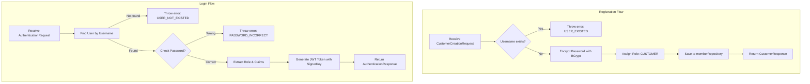

**2. Costume Service:**

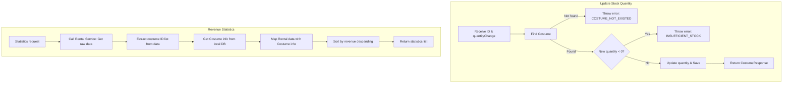

**3. Rental Service:**

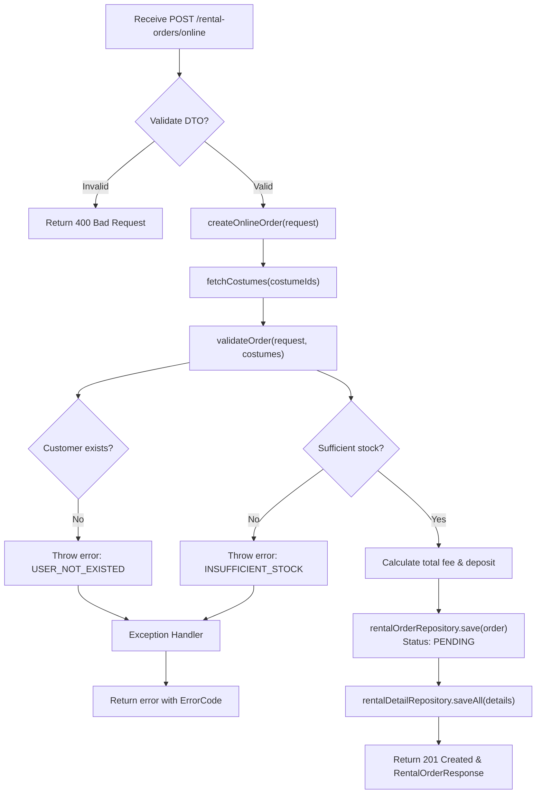

**Rental Service (Confirm Order):**

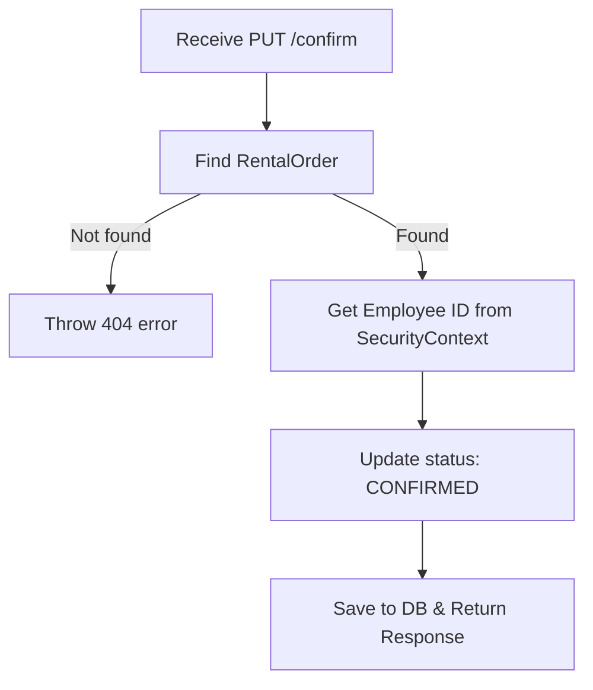

**4. Return Service:**

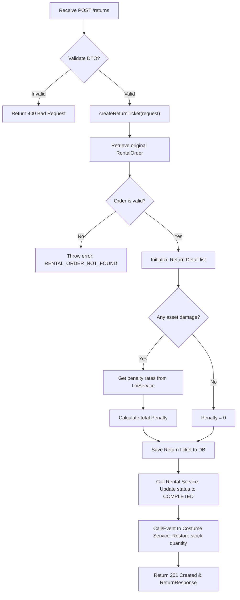

**5. Supplier Service:**

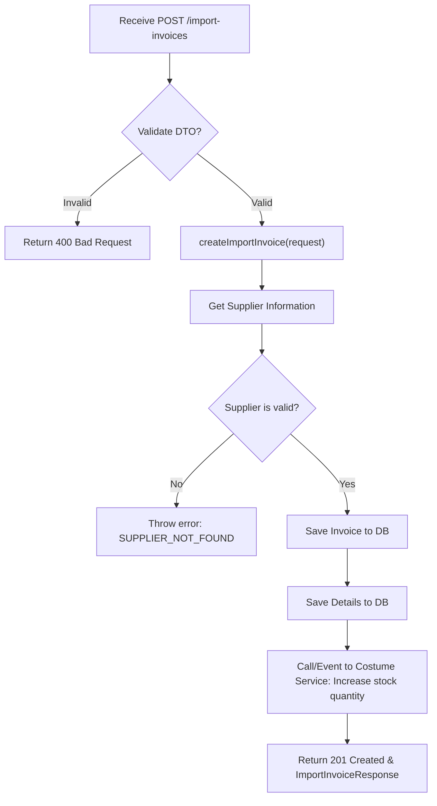
