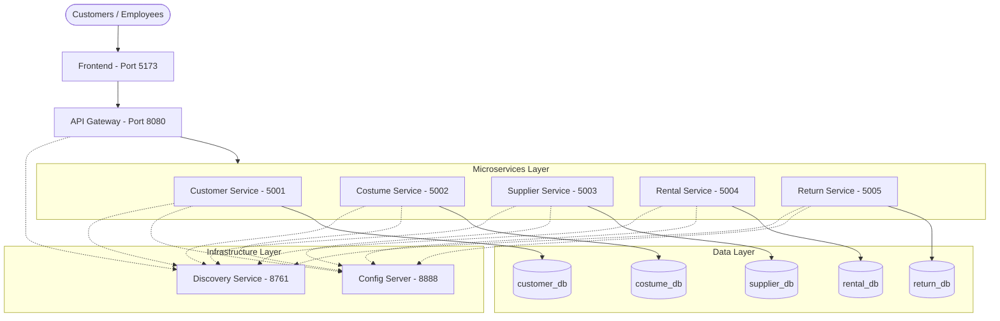

# System Architecture

> This document is completed **after** the [Analysis and Design](analysis-and-design.md) phase.
> Based on the identified Service Candidates and Non-Functional Requirements, we select appropriate architectural patterns and design the deployment architecture.

**References:**
1. *Service-Oriented Architecture: Analysis and Design for Services and Microservices* — Thomas Erl (2nd Edition)
2. *Microservices Patterns: With Examples in Java* — Chris Richardson
3. *Bài tập — Phát triển phần mềm hướng dịch vụ* — Hung Dang (available in Vietnamese)

---

## 1. Pattern Selection

Selection of architectural patterns based on business and technical justifications from the analysis process.

| Architectural Pattern | Selection | Business / Technical Justification |
|-------------------------|:---------:|-------------------------------|
| **API Gateway** | ✅ | Single entry point, handling routing and security (JWT). |
| **Database per Service** | ✅ | Ensures loose coupling and independent scalability for each service. |
| **Service Registry / Discovery** | ✅ | Using Netflix Eureka for services to automatically find each other without hardcoded IP configurations. |
| **Externalized Configuration** | ✅ | Using Spring Cloud Config Server to manage centralized configuration for all microservices. |
| **Circuit Breaker** | ✅ | Using Resilience4j to prevent cascading failures when a service encounters an issue. |

---

## 2. System Components

| Component | Responsibility | Tech Stack | Port |
|-----------|----------------|------------|------|
| **Frontend** | User Interface (Web) | React / Next.js | 5173 |
| **Gateway** | Request routing, JWT Authentication | Spring Cloud Gateway | 8080 |
| **Discovery Service** | Service registration and discovery management | Netflix Eureka | 8761 |
| **Config Service** | Provides centralized configuration | Spring Cloud Config | 8888 |
| **Customer Service** | Manages customers, employees and authentication | Spring Boot, MySQL | 5001 |
| **Costume Service** | Manages costumes and inventory | Spring Boot, MySQL | 5002 |
| **Supplier Service** | Manages suppliers and import invoices | Spring Boot, MySQL | 5003 |
| **Rental Service** | Manages rental orders and transaction lifecycle | Spring Boot, MySQL | 5004 |
| **Return Service** | Manages return slips and penalty calculation | Spring Boot, MySQL | 5005 |
| **Database** | Persistent data storage | MySQL 8.0 | 3306 |

---

## 3. Communication

### Inter-service Communication Matrix

| From → To | Gateway | Customer Svc | Costume Svc | Rental Svc | Return Svc | Supplier Svc |
|----------|:-------:|:------------:|:-----------:|:----------:|:----------:|:------------:|
| **Frontend** | REST | - | - | - | - | - |
| **Gateway** | - | REST (lb) | REST (lb) | REST (lb) | REST (lb) | REST (lb) |
| **Rental Svc** | - | Feign | Feign | - | - | - |
| **Return Svc** | - | - | Feign | REST | - | - |
| **Supplier Svc** | - | - | Feign | - | - | - |

> Note: **lb** (Load Balanced) via Eureka Service ID. Internal links use synchronous **Feign Client**.

---

## 4. Architecture Diagram

---

## 5. Deployment

- All services are packaged as **Docker Images**.
- Use **Docker Compose** to orchestrate and run the entire system with a single command.
- Execution command: `docker compose up --build`
- **Environment**: Java 17, Spring Boot 3.2+, MySQL 8.
